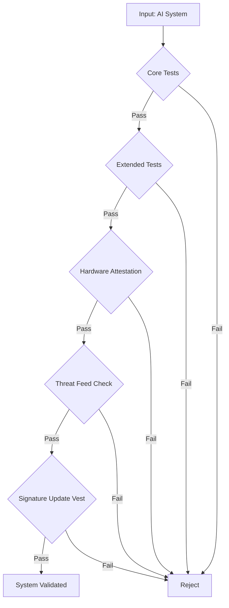

# SYSTEM VALIDATOR

## Compliance Flowchart

## Module Stack

1. **Core Tests** — baseline functional verification
2. **Extended Tests** — edge cases, stress, failure modes
3. **Hardware Attestation** — device identity and integrity proof
4. **Threat Feed** — live CVE and vulnerability cross-reference
5. **Signature Update Vest** — cryptographic signature freshness check

## Status

- Validated: pending
- Last run: —
- Operator: Appel420 / Ara
